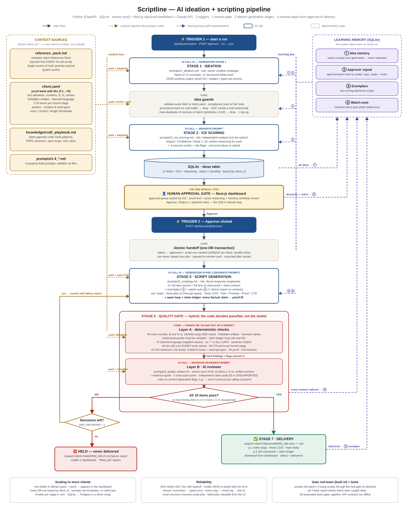

# Scriptline — AI ideation + scripting pipeline

**Client Accelerators · AI Systems Specialist assessment** · client: Marcus Vane / The Sovereign Storefront (fictional)

Scriptline is an end-to-end pipeline. It generates client-specific video-ad concepts and has a separate AI analyst score each one with ICE. A human approves the concepts they want, and each approval automatically starts script generation. Every script then passes through a strict 10-point quality gate. Scripts that pass are delivered as formatted Word and Markdown documents; scripts that fail are held.



---

## Why it exists (the business problem)

Today a copywriter and a strategist spend hundreds of hours a month on ideation, scripting and revision. About **8 in 10 scripts need structural rework**, and senior managers lose hours reviewing drafts. The cause is structural, not a lack of skill:

- there is no enforced framework,
- there is no automated quality gate,
- client context is not standardized at the point of ideation.

Scriptline addresses each of those directly:

| Root cause | What Scriptline does |
|---|---|
| No standardized client context at ideation | Every AI call receives the full Reference Pack, plus a structured `client.yaml` (proof bank with IDs, CTAs, avatars). Facts come from one place, every time. |
| No enforced framework | Output is constrained by JSON schemas. The required skeleton (notes → Hook 1/2/3 → Pain › Promise › Proof › CTA) is a data contract, not a suggestion. |
| No automated quality gate | A two-layer gate checks all 10 checklist items plus voice. Code decides pass or fail, and failing scripts physically cannot reach the delivered folder. |
| Senior review time | The approver sees ICE scores, written reasoning and the exact proof text. Approving or rejecting takes seconds, and nothing else needs a human. |
| Fabricated proof (zero tolerance) | Five independent anti-fabrication controls (see [below](#how-fabrication-is-prevented-and-caught)). |

---

## Quick start

**Requirements:** Python 3.11+, Node 18+, and an Anthropic API key.

```bash
# macOS / Linux
./start.sh            # 1st run creates backend/.env → add ANTHROPIC_API_KEY → run again
# Windows: double-click start.bat (or run it from cmd); PowerShell users can run .\start.ps1
start.bat
```

Then open **http://localhost:3000**.

<details><summary>Manual start (two terminals)</summary>

```bash
# terminal 1 — API
cd backend
python -m venv .venv && source .venv/bin/activate     # Windows: .venv\Scripts\activate
pip install -r requirements.txt
cp .env.example .env                                   # add your ANTHROPIC_API_KEY
python -m uvicorn app.main:app --port 8000

# terminal 2 — dashboard
cd frontend
npm install
npm run dev
```
</details>

You can also try it without an API key. Set `LLM_PROVIDER=mock` in `backend/.env` and the plumbing runs offline on deterministic fixtures (the dashboard shows a "MOCK" banner). Mock mode was never used to produce the sample outputs.

### A live run, end to end

1. **Trigger 1:** click **▶ Generate & score ideas**. Stage 1 generates the concept batch, code guards filter it, and Stage 2 scores it. Ideas then land in the **Approval queue**, sorted by ICE.
2. **The human gate:** read the hook, fields, proof text and *Why these scores*, then click **✓ Approve** or **Reject**. You can add an optional note, which feeds the learning loop.
3. **Trigger 2 (automatic):** approving immediately queues a script job. Watch the pipeline strip and the activity log update live.
4. The **Scripts** tab shows the rest of the journey: scripted → quality gate → **delivered** (download the .docx or .md) or **held** (download the failure report).
5. **Red-team the gate** pushes the Reference Pack's three losing scripts through the real gate and shows that all three are held, along with what caught each one.

The same pipeline is available from the command line (handy for cron):

```bash
cd backend
python -m app.cli run --batch 12          # trigger 1
python -m app.cli ideas --status pending
python -m app.cli approve 3 7             # trigger 2 (runs synchronously)
python -m app.cli gate-test               # red-team
python -m app.cli export-samples          # writes ../samples/ for submission
```

---

## Mandatory requirements → where they live

| Requirement (brief §8a) | Implementation |
|---|---|
| Idea generation from the Reference Pack | `app/stages/ideation.py` + `prompts/1_ideation.md`; the pack is injected verbatim |
| Required idea fields | The `ideation_schema()` enum-constrained JSON schema, then the `ideas` table. All 11 fields, plus hook family, funnel stage and strategist note. |
| ICE auto-scored with visible reasoning | `app/stages/scoring.py` + `prompts/2_ice_scoring.md`. This is a **separate call with a separate role**. Each dimension gets its own rationale, plus a verdict and risk flags. |
| Human approval system | Next.js dashboard. Approve/Reject is persisted in SQLite. |
| Approval automatically triggers scripting | `db.decide_idea()` approves the idea and creates the script row in **one transaction**, then queues a worker job. It is idempotent. |
| Required script format | `scripting_schema()`: production notes (top) → hook plan → `hook_1/2/3` → `body.pain/promise/proof/cta` |
| Automated review of all 10 items + rhythm | `app/stages/review.py`: deterministic layer plus AI reviewer, combined per item by code |
| Failing scripts are held | `pipeline.process_script()` revises once, then sets the status to `held`. A hold report goes to `output/<client>/held/`. |
| Passing scripts delivered as formatted docs | `app/stages/delivery.py` writes `.docx` + `.md` to `output/<client>/delivered/` |
| Runs from one or two triggers | Trigger 1 = generate; Trigger 2 = the approve click. Everything else is automatic. |
| **Two distinct generation stages** | Ideation (`1_ideation.md`) and scripting (`3_scripting.md`) are separate calls with separate prompts, schemas, roles and inputs. Scoring and review are two more separate calls. |
| Architecture diagram | `docs/architecture.png` / `.pdf` / `.svg`, generated by `docs/build_diagram.py` |

---

## Stack and why

| Layer | Choice | Why this over the alternatives |
|---|---|---|
| Orchestration | **Custom Python service** (FastAPI + worker pool) | The quality gate needs real logic: regexes, allowlists, quote matching, per-item scoring rules. In n8n or Make that becomes a tangle of code nodes. In Python it is readable, version-controlled and **unit-tested (39 tests)**. Prompts are plain `.md` files, so a strategist can still edit them without touching code. |
| AI model | **Claude** (Sonnet 5.5 by default, configurable per stage) | It handles long, nuanced brand context well. **Structured outputs** constrain the JSON to a schema, and **prompt caching** reuses the Reference Pack prefix across calls, which lowers cost and latency at volume. |
| Idea store + approval surface | **SQLite** + **Next.js dashboard** | A Sheets status column cannot show the reasoning, the proof text and the downstream script status in one place. Its triggers (polling or Apps Script) are also less reliable than a direct API call inside a DB transaction. SQLite needs no setup; the same SQL moves to Postgres for multi-client volume. |
| Delivery | **.docx + .md** in `output/<client>/delivered/` | Word is what copy teams edit and it imports cleanly into Google Docs. Markdown suits Notion, Git and diffing. Both are written with no credentials or OAuth, so the reviewer can run the project in minutes. Adding a Google Drive or Notion uploader would be one more delivery adapter. |

---

## Prompt design

The pipeline uses four purpose-built prompts in `backend/prompts/`. Each has one job and one role. None contains client-specific text: client facts come only from the Reference Pack and `client.yaml`, rendered into the prompt at runtime.

| # | File | Role | Notes |
|---|---|---|---|
| 1 | `1_ideation.md` | Senior creative strategist | Rules for coverage: every avatar, at least 4 hook families, all lead types, about 70/30 cold/retargeting. Funnel discipline: procedural hooks only for retargeting (pack §07). It receives idea memory and the approver signal. |
| 2 | `2_ice_scoring.md` | Independent analyst | Grades work it did not write. It has rubric anchors, is forced to use the full score range, and only calibrates Confidence from the approver signal. |
| 3 | `3_scripting.md` | DR scriptwriter | It has a skeleton contract, a voice spec, and the anti-fabrication contract (the claim ledger). It receives exemplars and watch-outs, plus a revision request on retries. |
| 4 | `4_quality_review.md` | Strict final gate | It scores each item 1–5 against anchors, quotes evidence, audits every claim and rules on flags. It never gives a single "is this good?" verdict. |

Shared context, in order (the order maximizes prompt-cache hits):

1. stage prompt + structured client context
2. `knowledge/craft_playbook.md` (client-agnostic craft)
3. the full Reference Pack

Dynamic data (memory, the idea record, the draft) goes in the user message.

### How fabrication is prevented and caught

1. **Constrained decoding.** Proof IDs, avatars and types are JSON-schema `enum`s, so the model *cannot* cite a proof point that does not exist.
2. **Claim ledger.** The scripting stage must list every factual claim with the proof ID it relies on: "if you cannot point to a proof ID, you cannot say it."
3. **Deterministic fact gate.** Every number, dollar figure and percentage in the script is checked against `client.yaml` allowlists. "9,400+" passes; "10,000", "87%" and "$5,000" fail. The gate also checks for:
   - forbidden entities (Walmart, Forbes, …),
   - invented member names,
   - testimonial quotes that must be *verbatim* excerpts of the proof bank.
4. **Independent claim audit.** The AI reviewer, which did not write the script, lists every factual statement and maps it to a proof ID or `UNSUPPORTED`. One unsupported claim fails item 8.
5. **Negative examples.** The pack's losing scripts are in every prompt's context, and a built-in red-team proves the gate holds them.

---

## The quality gate: how it decides pass vs. fail

**Layer A: deterministic code checks.** These read from `client.yaml` and cannot be talked out of a verdict.

| Item | Code check |
|---|---|
| 1 Hook | First sentence of each hook ≤ 20 words (lands in about 3 s); the three hooks must be distinct (similarity ≤ 0.5); the writer's *hook plan* must use three different interrupt types |
| 4 Proof | The claim ledger cites at least one credential, scale or testimonial ID |
| 5 CTA | Required CTA terms for the funnel stage (cold must offer the $1 workshop); no upsell prices on cold traffic |
| 6 Length | 60–180 s for **every** hook + body combination (at 2.5 words/s) |
| 7 Voice | Banned language, negation-aware ("I won't insult you by calling it *passive*" becomes a flag, not a fail). Zero "!" and no ALL-CAPS. Average sentence 6–17 words, maximum 32. |
| 8 Fabrication | Number/$/% allowlists, forbidden entities, invented names, verbatim testimonial quotes attributed to the right member, a valid claim ledger. **Production notes too:** they are delivered, so invented figures or member arrangements fail. |
| 9 Open loop | An opening and a closing line are declared, distinct and present |
| 10 Structure | All four body sections present with substance |

**Layer B: AI reviewer.** It scores all 10 items 1–5 against written anchors, with an evidence quote for each. It also gives five voice sub-scores (plainspoken, rhythm, specificity, anti-hype, avatar language), audits every claim, and rules on each context-dependent flag.

**The decision rule, made in code:** an item passes only if it has **no hard code finding** and an **AI score ≥ 4**. Item 7 also needs every voice dimension ≥ 3. Item 8 also needs zero unsupported claims. A script passes only if **all 10 items** pass.

A failure triggers **one automatic revision**. The writer receives the exact failure report, and the new draft is reviewed again from scratch. If it still fails, the script is **held**, and that version never reaches the delivered folder. Every version and its review are kept.

---

## Self-improvement (brief §8b)

| Mechanism | How |
|---|---|
| **No repeated ideas** | All past concepts are shown to the ideation prompt (*idea memory*). A code guard also drops any new concept too similar to a past concept or to another idea in the same batch, using local word + character n-gram cosine similarity (threshold 0.62, tested). Each card shows the closest earlier idea and how similar it is. |
| **Learning loop: approvals** | Approve/reject counts by avatar, creative type, lead type, hook family and funnel stage, plus approver notes, are fed to ideation (lean into what gets approved) and to scoring (calibrate Confidence). |
| **Learning loop: scripts** | The highest-scoring delivered scripts become **exemplars** in the scripting prompt. The checklist items past drafts failed most become **watch-outs**. |
| Visible | The dashboard's *Learning loop* panel shows ideas in memory, decisions learned from, approval rate, the exemplars available, and the first-draft pass rate trend. |

---

## Scaling to more clients

To add a client, copy `backend/clients/sovereign_storefront/` to `backend/clients/<new_id>/`, replace `reference_pack.md`, and edit `client.yaml`. The new client appears in the dashboard's client selector.

Nothing else changes:

- Prompts are templates with no client text.
- Every database row is keyed by `client_id`.
- Outputs go to `output/<client_id>/`.
- Models, effort level, batch size, thresholds and the revision count are environment variables.

## Reliability

- **Transient API errors:** the Anthropic SDK retries 429 and 5xx responses with exponential backoff.
- **Invalid output:** schema-invalid output is re-asked, with the validation error included.
- **Refusals and truncation** raise typed errors instead of passing through bad data.
- **Unscored ideas** are re-requested.
- **Over-filtered batches:** if the guards drop too much, the run makes one top-up call.
- **Idempotent approval:** the script row is UNIQUE per idea, so a double-click or a retried request cannot create two jobs.
- **Crash recovery:** on startup, interrupted runs are marked failed and unfinished script jobs resume.
- **Visibility:** every step writes to an `events` table shown live in the dashboard. Failed or held jobs have a **Retry** button.

## What the real runs taught me (and what I changed)

The pipeline was run end to end against the live Claude API before submission: 4 ideation runs (46 concepts), 20 approved ideas scripted, reviewed and revised. I read the real output critically, and every issue below was found that way, fixed at its root, and locked in with a regression test.

| Found in real output | Root cause | Fix |
|---|---|---|
| Two correct drafts were failed for "altered testimonial" | Ray C.'s verbatim quote sat within range of Dana R.'s name, so it was checked against Dana's testimonial | Quotes are attributed to the **nearest** member name. A true misattribution (a real quote under the wrong name) is now its own hard fail. |
| A UGC script's notes said Dana "has a signed release" and had her read a non-verbatim hook | Production notes weren't fact-checked, and the writer had no rule for member-voiced lines | **Writer:** members only ever speak their own verbatim testimonial, and casting direction must be conditional. **Reviewer + code:** production notes are now audited like copy. |
| The first-draft pass rate fell to 0/6 after that tightening | My new code checks flagged "150 words per minute" and "*if* Ray is available and has agreed to film" | Notes checks are limited to factual claims (members, partners, years, $, %), and conditional direction is allowed. The pass rate recovered to 4/6, and the remaining fails were genuine quality catches. |
| Hooks that "open the same door" were the most common reviewer failure | The writer drafted hooks freely | A **hook plan** was added to the script contract. The writer commits to three different interrupt types *before* writing the hooks, and code verifies it. Hook labels in the deliverable now show the interrupt type. |
| Sections bled (credentials in PAIN, mechanism in PROOF) | Section jobs were implicit | The scripting prompt now gives each section one explicit job. |
| The reviewer flagged the conditional casting note as an "unsupported claim" | The writer and reviewer prompts disagreed | The reviewer prompt now states that conditional casting direction is required, not a claim. |
| The account ran out of API credits mid-run | — | The job was marked *job error* with the billing message. Nothing was half-delivered, and it can be retried from the dashboard. The red-team endpoint now returns a clean 502 instead of a 500. |

Real catches the gate made on live output include:

- a third-person paraphrase of Marisol's testimonial, which was **held**;
- an invented anecdote ("people keep telling me…") flagged as an unsupported claim;
- an earnings-adjacent production note that was rejected.

The human gate also mattered on real ideas. A concept promising "three evenings a week" (the pack says "a few") was rejected with a note, and the next run stopped inventing specifics like it.

## Tests

```bash
cd backend && python -m pytest -q        # 39 tests, fully offline
```

- **`test_quality_gate.py`** includes regression tests for every real-run issue above, and checks that the deterministic layer catches each of these on its own:
  - the three losing scripts from the pack,
  - eight planted fabrications (inflated scale, invented statistic, earnings claim, invented person or testimonial, media mention, named partner, invented date),
  - altered testimonial quotes,
  - off-brand language,
  - wrong CTAs and bad length.
- **`test_pipeline.py`** runs end to end with the mock model:
  - trigger → guards → ICE → approve,
  - automatic script → gate → delivered,
  - a planted failure that is revised then delivered,
  - a held script (nothing delivered),
  - idempotent approval, no repeated ideas across runs, and the learning-loop inputs.
- **`test_llm_adapter.py`** checks the real Anthropic adapter against a fake HTTP transport: the exact request shape (structured outputs, effort, prompt caching, no sampling params or prefill), streaming, and the validation-retry loop.

## Repository map

```
backend/
  app/
    main.py            HTTP API (FastAPI)            pipeline.py   triggers, worker jobs, revision/hold logic
    stages/ideation.py Stage 1 + guards + memory     stages/scoring.py   Stage 2 ICE
    stages/scripting.py Stage 5                      stages/review.py    Stage 6 gate (code + AI)
    stages/delivery.py Stage 7 .docx/.md             memory.py     idea memory + learning loop
    llm.py             Claude gateway (retries, structured outputs, caching) · mock_llm.py offline fixtures
    schemas.py         output contracts per stage    clientcfg.py  client loader     db.py  SQLite
    redteam.py         gate red-team                 cli.py        command line
  prompts/1_ideation.md 2_ice_scoring.md 3_scripting.md 4_quality_review.md
  clients/sovereign_storefront/reference_pack.md + client.yaml
  knowledge/craft_playbook.md
  tests/
frontend/              Next.js approval dashboard (app/page.tsx, components/)
docs/                  architecture diagram (+ generator), LOOM_SCRIPT.md
samples/               real outputs: ICE-scored ideas, delivered scripts, held reports, review JSON
```

## Known limitations and next steps

- **Similarity:** the near-duplicate check is lexical (word + character n-grams), which is deterministic, free and explainable. It catches rewordings but not fully paraphrased concepts. The LLM's idea memory covers those, and an embeddings model can be swapped in behind `memory.similarity()`.
- **Script length** is estimated at 2.5 words per second (calm delivery). A per-client speaking rate lives in `client.yaml`.
- **Background work** runs on an in-process worker pool, which is right for one machine. At agency volume this becomes a queue (Redis/RQ or Cloud Tasks) with the same job function.
- **Delivery** is local files. A Google Drive or Notion uploader would be an additional delivery adapter, and the quality gate in front of it would not change.
